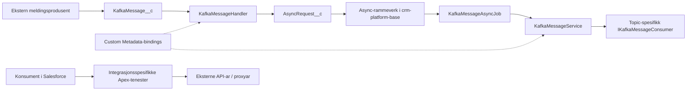

# Systemoversikt

**Status: Førsteutkast basert på statisk lesing av kjeldekode og metadata.**
Dokumentet skildrar pakken, ikkje eit verifisert oppsett i eit bestemt miljø.

## Ansvar og avgrensing

`crm-platform-integration` er ein Salesforce Unlocked Package med mottak og
handsaming av Kafka-meldingar, callout-tenester, synkronisering og
integrasjonsspesifikke datatypar. Pakken er ikkje eit eige fagprodukt og er
ikkje avgrensa til éin konsument.

Pakkekjelde, avhengigheiter og API-versjon er definerte i
[`sfdx-project.json`](../../sfdx-project.json). `force-app/` er pakkekjelda;
`src-temp/` er ikkje eit alternativt område for produktutvikling.

## Komponentar

Diagrammet viser logiske komponentar, ikkje nettverk, tilgang eller fullstendig
utrullingsarkitektur. Kafka-produsenten og den eksterne transporten er ikkje
implementerte av denne meldingsflyten i Apex.

## Pakke- og konfigurasjonsgrenser

-   `crm-platform-base` leverer mellom anna async-rammeverket som Kafka-jobben
    byggjer på. Bevar grensa mellom meldingshandsaming og jobbplanlegging.
-   Manifestet deklarerer også `platform-data-model`, `custom-metadata-dao`,
    `custom-permission-helper`, `feature-toggle`, `crm-shared-flowComponents` og
    `crm-henvendelse-base`. Bruk manifestet for gjeldande versjonar.
-   Konkrete klassar blir mellom anna valde gjennom Custom Metadata og
    `Type.forName`. Ei klasse utan direkte Apex-kall kan derfor vere aktiv.
-   `CRM_PerformSync` lastar klassar frå `Sync_Class_Binding__mdt` og kallar
    `CRM_SyncInterface.doSync()`. Aktive bindingar og planlagde jobbar i eit
    miljø er ikkje verifiserte her.
-   Callout-tenester brukar ulike mønster. Fleire brukar `ApiController`, medan
    Altinn 3 også byggjer HTTP-kall direkte. Ikkje føreset éin felles
    autentiserings- eller retry-kontrakt.

## Vidare lesing og avklaringar

-   [Repositorystruktur](repositorystruktur.md)
-   [Datamodell og konfigurasjon](datamodell.md)
-   [Integrasjonskatalog](../integrations/README.md)
-   [Kafka-kontrakt](../surfaces/kafka.md)

Teamet må stadfeste systemeigarskap, aktive konsumentar, miljøkonfigurasjon,
driftsansvar og krav til oppbevaring. Dette utkastet er ikkje ei ny
arkitekturavgjerd; slike avgjerder høyrer til i [ADR-ar](../adr/README.md).

## Kjeldegrunnlag

-   [KafkaMessageHandler](../../force-app/main/default/classes/KafkaMessageHandler.cls)
-   [KafkaMessageAsyncJob](../../force-app/main/default/classes/KafkaMessageAsyncJob.cls)
-   [KafkaMessageService](../../force-app/main/default/classes/KafkaMessageService.cls)
-   [CRM_PerformSync](../../force-app/main/default/classes/CRM_PerformSync.cls)
