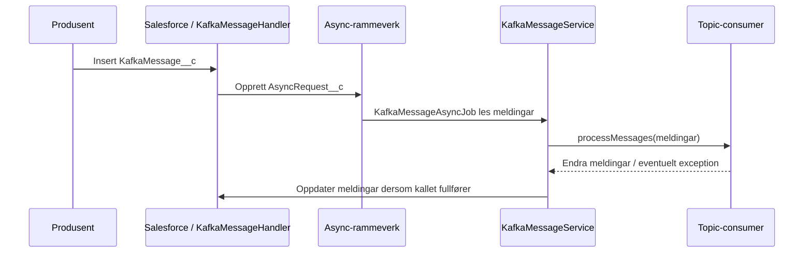

# Kafka-mottak og consumer-kontrakt

**Status: Førsteutkast basert på Apex-koden.** Dette er Salesforce-sida av
kontrakten. Ekstern produsent, topic-skjema og transporttilgang må dokumenterast
med systemeigar.

## Meldingsfelt

| Felt på `KafkaMessage__c` | Bruk                            |
| ------------------------- | ------------------------------- |
| `CRM_Topic__c`            | Vel routing og consumer-binding |
| `CRM_Key__c`              | Topic-spesifikk nøkkel          |
| `CRM_Value__c`            | Payload som consumeren tolkar   |
| `CRM_Status__c`           | Handsamingsstatus               |
| `CRM_ErrorMessage__c`     | Feilinformasjon frå handsaming  |

Desse API-namna kjem frå [feltmetadataen](../../force-app/main/default/objects/KafkaMessage__c/fields/).
Rot-README-en omtalar nokre felt utan `CRM_`-prefiks; bruk metadataen ved
implementasjon.

## Handsaming

1. Innsetting av meldingar går gjennom `KafkaMessageTrigger` og
   trigger-rammeverket `MyTriggers`.
2. `KafkaMessageHandler.onAfterInsert` grupperer meldingar etter topic og
   brukar konfigurerte `IKafkaMessageFilter`-klassar der dei finst.
3. Når prosessering er aktivert, blir async-oppdrag oppretta for meldingane som
   skal vidare. Handler-bindinga kan styre jobbtype og prioritet.
4. `KafkaMessageAsyncJob` les meldingane med ID-ar frå oppdraget og sender dei
   til `KafkaMessageService`.
5. Servicen opprettar consumerar frå metadata, nullstiller feiltekst og set
   status til `Pending` før topic-gruppert handsaming.
6. Consumeren blir kalla gjennom `processMessages(List<KafkaMessage__c>)`.
   Servicen oppdaterer deretter meldingane.

## Feil, ny handsaming og sletting

-   Manglande topic-binding gir `Error` og teksten `No topic binding found`.
-   `IKafkaMessageConsumer` seier at consumeren sjølv må fange feil dersom dei
    skal lagrast på den enkelte meldinga. Uhandterte feil går vidare til
    async-rammeverket; ikkje føreset at kvar melding då får ein oppdatert feil.
-   Statuskonstantane er `Pending`, `Processed`, `Error` og `Warning`.
    Kva som gir dei ulike utfalla, avheng også av consumeren.
-   Overgang frå ein annan status til `Pending` opprettar nytt async-oppdrag når
    prosessering er aktivert. Dette er ikkje ein garanti for automatisk retry.
-   Når sletting er aktivert, kan overgang til `Processed` føre til permanent
    opprydding. Sjå [datamodellen](../architecture/datamodell.md).
-   I sandbox brukar consumer-routing
    `SandboxOverrideTopic__c` når feltet er utfylt. Filterbindinga er ei separat
    kopling og må kontrollerast sjølvstendig.

Rekkjefølgje, duplikattoleranse og idempotens må vurderast per topic. Det er
ikkje dokumentert ein felles exactly-once-garanti her.

## Kjelde og vidare verifikasjon

-   [Handler](../../force-app/main/default/classes/KafkaMessageHandler.cls)
-   [Service](../../force-app/main/default/classes/KafkaMessageService.cls)
-   [Consumer-interface](../../force-app/main/default/classes/IKafkaMessageConsumer.cls)
-   [Service-test](../../force-app/main/default/classes/KafkaMessageServiceTest.cls)
-   [Handler-test](../../force-app/main/default/classes/KafkaMessageHandlerTest.cls)

Desse testane er kjelder å lese; dei er ikkje køyrde som del av dette utkastet.
Konkrete retry-/oppryddingsoperasjonar krev ein godkjend runbook.
